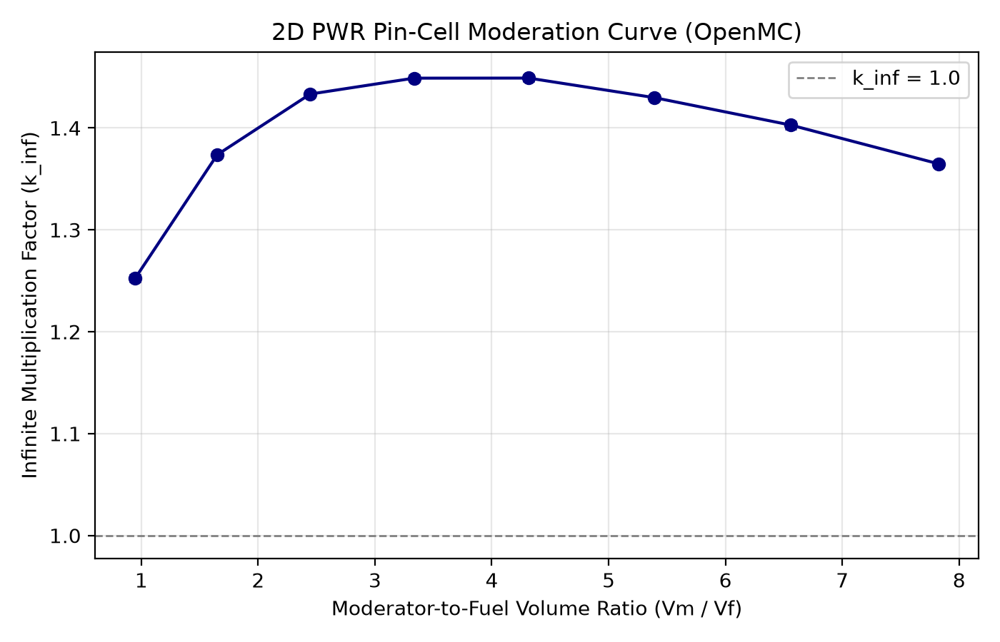

# 2D PWR Pin-Cell Moderation Study (OpenMC)

Introductory Monte Carlo eigenvalue calculation (`k_inf`) on a 2D infinite PWR fuel pin-cell using OpenMC.

By varying the square lattice pitch while keeping the UO2 fuel and Zircaloy cladding radii fixed, the script illustrates the transition from under-moderated to over-moderated regimes as a function of the moderator-to-fuel volume ratio (`Vm / Vf`).



## Run
```bash
python pincell_study.py
```
